# Awesome Pi Mobile

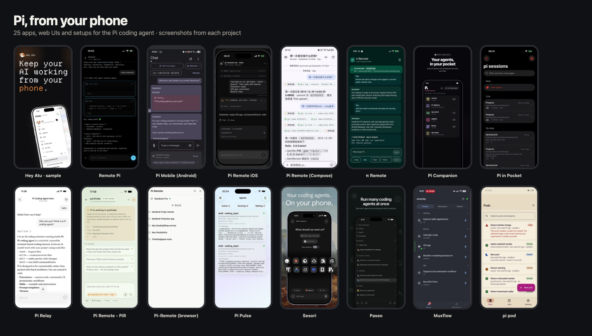

Every way to use the [Pi coding agent](https://github.com/earendil-works/pi) from your phone: native apps, phone-first web apps, notifications, multi-agent clients and plain SSH.

Pi runs in a terminal on your computer and has no official phone app. These 25 projects keep Pi where your code is and bring the session to your pocket: follow the work, answer its questions, steer it or start a new run.

Updated 2026-11-15. Star counts come from GitHub on that date.

## Contents

- [Phone apps](#phone-apps) (11)
- [Phone-first web apps](#phone-first-web-apps) (6)
- [Notifications](#notifications) (2)
- [Multi-agent apps with Pi support](#multi-agent-apps-with-pi-support) (4)
- [Do it yourself](#do-it-yourself) (2)
- [Choosing one](#choosing-one)
- [Guides and discussions](#guides-and-discussions)
- [Contributing](#contributing)

## Phone apps

Native iPhone or Android apps that pair with the Pi on your computer.

<table>
<tr><td width="25%" valign="top"><a href="https://github.com/jacobaraujo7/remote_pi">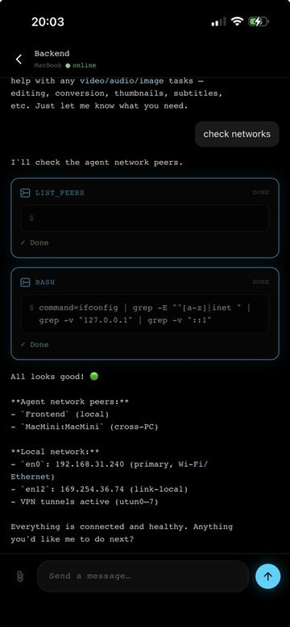</a> <b><a href="https://github.com/jacobaraujo7/remote_pi">Remote Pi</a></b> · ⭐ 493 Chat with your local Pi and watch tool calls; also a local agent mesh. Screenshot: <a href="https://apps.apple.com/us/app/remote-pi-coding-agent/id6773499691">from the project</a></td><td width="25%" valign="top"><a href="https://github.com/ayagmar/pi-mobile">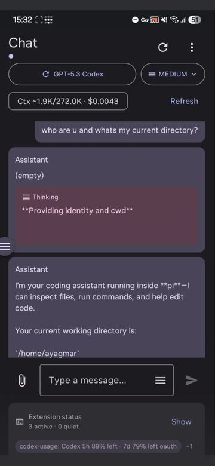</a> <b><a href="https://github.com/ayagmar/pi-mobile">Pi Mobile (Android)</a></b> · ⭐ 118 Browse, resume and steer sessions over Pi's RPC mode. Screenshot: <a href="https://github.com/ayagmar/pi-mobile">from the project</a></td><td width="25%" valign="top"><a href="https://github.com/tornikegomareli/pi-remote-ios">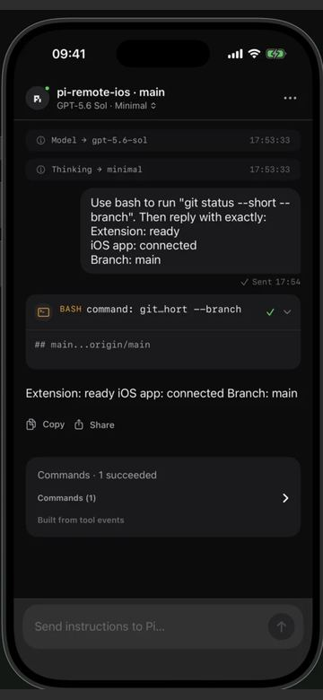</a> <b><a href="https://github.com/tornikegomareli/pi-remote-ios">Pi Remote iOS</a></b> · ⭐ 14 Controls the active terminal session; early preview. Screenshot: <a href="https://github.com/tornikegomareli/pi-remote-ios">from the project</a></td><td width="25%" valign="top"><a href="https://github.com/kikyous/pi-remote">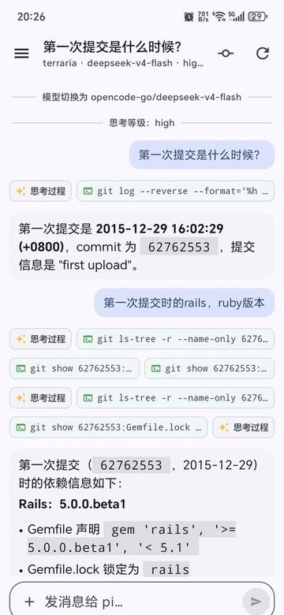</a> <b><a href="https://github.com/kikyous/pi-remote">Pi Remote (Compose)</a></b> · ⭐ 12 Sessions grouped by project, live view and chat from the couch. Screenshot: <a href="https://github.com/kikyous/pi-remote">from the project</a></td></tr>
<tr><td width="25%" valign="top"><a href="https://github.com/nucleoid/pi-remote">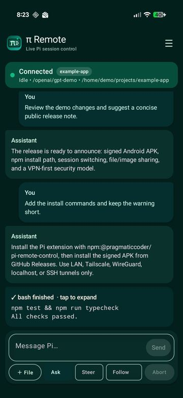</a> <b><a href="https://github.com/nucleoid/pi-remote">π Remote</a></b> · ⭐ 2 Monitor and steer a Pi TUI or RPC session. Screenshot: <a href="https://github.com/nucleoid/pi-remote">from the project</a></td><td width="25%" valign="top"><a href="https://apps.apple.com/us/app/pi-companion/id6793307134">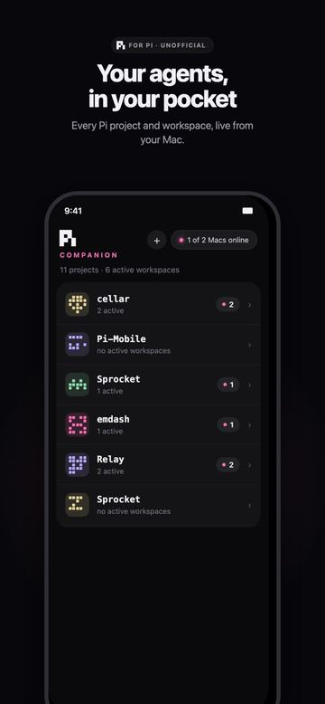</a> <b><a href="https://apps.apple.com/us/app/pi-companion/id6793307134">Pi Companion</a></b> · ⭐ 1 Projects, sessions and full history, using Pi's documented session files and RPC mode. Screenshot: <a href="https://apps.apple.com/us/app/pi-companion/id6793307134">from the project</a></td><td width="25%" valign="top"><a href="https://heyatu.com/pi?utm_source=github&utm_medium=readme&utm_campaign=awesome-pi-mobile">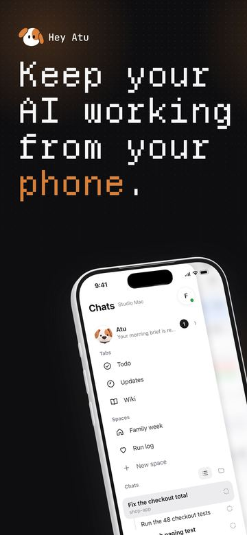</a> <b><a href="https://heyatu.com/pi?utm_source=github&utm_medium=readme&utm_campaign=awesome-pi-mobile">Hey Atu</a></b> ¹  Continues a terminal Pi session on the phone, with Todo, Updates, Days and Wiki around it. Uses the Pi you already have. Screenshot: <a href="https://heyatu.com/pi?utm_source=github&utm_medium=readme&utm_campaign=awesome-pi-mobile">sample</a></td><td width="25%" valign="top"><a href="https://pi-ios.huddee.com/">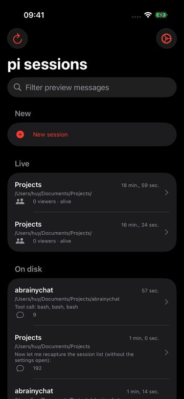</a> <b><a href="https://pi-ios.huddee.com/">Pi in Pocket</a></b>  Monitor and control Pi; no analytics. Screenshot: <a href="https://pi-ios.huddee.com/">from the project</a></td></tr>
<tr><td width="25%" valign="top"><a href="https://apps.apple.com/gb/app/pi-relay/id6768893799">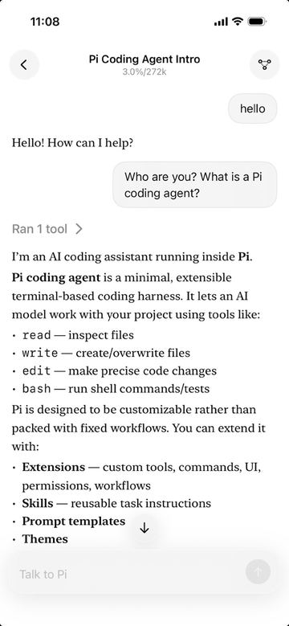</a> <b><a href="https://apps.apple.com/gb/app/pi-relay/id6768893799">Pi Relay</a></b>  Browse sessions, navigate trees, fork or clone conversations. Screenshot: <a href="https://apps.apple.com/gb/app/pi-relay/id6768893799">from the project</a></td><td width="25%" valign="top"><a href="https://apps.apple.com/us/app/pi-remote-pir/id6825822048">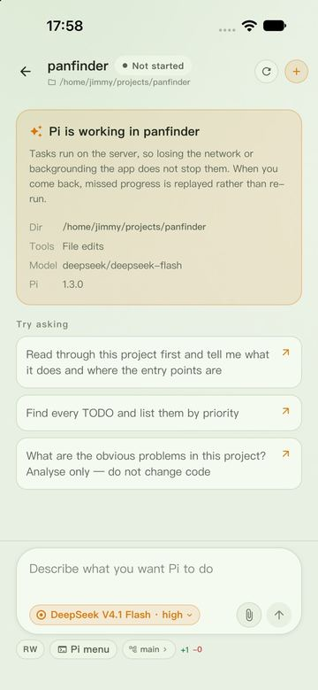</a> <b><a href="https://apps.apple.com/us/app/pi-remote-pir/id6825822048">Pi Remote - PiR</a></b>  Chat, watch Pi work, review the diff and commit. Screenshot: <a href="https://apps.apple.com/us/app/pi-remote-pir/id6825822048">from the project</a></td><td width="25%"></td><td width="25%"></td></tr>
</table>

| Project | Platforms | How the phone reaches Pi | Stars | What you get |
|---|---|---|---|---|
| [Remote Pi](https://github.com/jacobaraujo7/remote_pi) | iPhone, Android | QR pairing over a relay; the community relay can read messages, or self-host it | ⭐ 493 | Chat with your local Pi and watch tool calls; also a local agent mesh. |
| [Pi Mobile (Android)](https://github.com/ayagmar/pi-mobile) | Android | Tailscale | ⭐ 118 | Browse, resume and steer sessions over Pi's RPC mode. |
| [Pi Remote iOS](https://github.com/tornikegomareli/pi-remote-ios) | iPhone (build with Xcode) | Paired WebSocket | ⭐ 14 | Controls the active terminal session; early preview. |
| [Pi Remote (Compose)](https://github.com/kikyous/pi-remote) | iPhone, Android | Local network | ⭐ 12 | Sessions grouped by project, live view and chat from the couch. |
| [π Remote](https://github.com/nucleoid/pi-remote) | Android | WebSocket daemon on your network; not for the open internet | ⭐ 2 | Monitor and steer a Pi TUI or RPC session. |
| [Pi Companion](https://apps.apple.com/us/app/pi-companion/id6793307134) | iPhone (App Store) | Companion server on your Mac | ⭐ 1 | Projects, sessions and full history, using Pi's documented session files and RPC mode. |
| [Hey Atu](https://heyatu.com/pi?utm_source=github&utm_medium=readme&utm_campaign=awesome-pi-mobile) ¹ | iPhone, iPad (coming soon); Mac app, Terminal | Outbound connection to an end-to-end encrypted relay; no port or VPN | — | Continues a terminal Pi session on the phone, with Todo, Updates, Days and Wiki around it. Uses the Pi you already have. |
| [Pi in Pocket](https://pi-ios.huddee.com/) | iPhone, iPad (App Store) | Open-source bridge server on your computer | — | Monitor and control Pi; no analytics. |
| [Pi Relay](https://apps.apple.com/gb/app/pi-relay/id6768893799) | iPhone (App Store) | QR pairing with your own Pi remote | — | Browse sessions, navigate trees, fork or clone conversations. |
| [Pi Remote - PiR](https://apps.apple.com/us/app/pi-remote-pir/id6825822048) | iPhone (App Store) | SSH to your Linux server | — | Chat, watch Pi work, review the diff and commit. |
| [pi.dev remote (Clever Cloud)](https://pi.ai.labs.clever.cloud/) | iPhone (open beta), browser | Relay hosted by Clever Cloud | — | Send prompts, approve tool calls, answer questions, stop a run. |

## Phone-first web apps

Open a page on your phone; a small server or extension next to Pi serves it.

<table>
<tr><td width="25%" valign="top"><a href="https://github.com/Xpropel/Pi-Remote">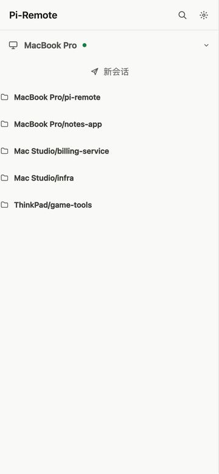</a> <b><a href="https://github.com/Xpropel/Pi-Remote">Pi-Remote (browser)</a></b> · ⭐ 330 Mirrors a live terminal session to the browser; send messages and commands back. Screenshot: <a href="https://github.com/Xpropel/Pi-Remote">from the project</a></td><td width="25%"></td><td width="25%"></td><td width="25%"></td></tr>
</table>

<table>
<tr><td width="50%" valign="top"><a href="https://github.com/tannermidd/pi-pocket">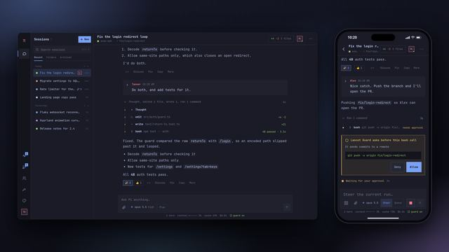</a> <b><a href="https://github.com/tannermidd/pi-pocket">Pi Pocket</a></b> · ⭐ 841 Durable, multiplayer, mobile-first web app for Pi; runs keep going after a restart. Screenshot: <a href="https://github.com/tannermidd/pi-pocket">from the project</a></td><td width="50%" valign="top"><a href="https://github.com/BlackBeltTechnology/pi-agent-dashboard">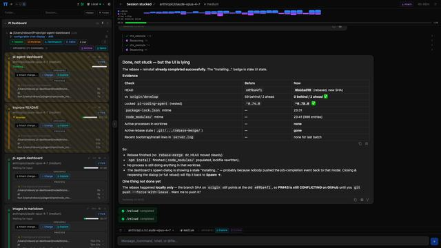</a> <b><a href="https://github.com/BlackBeltTechnology/pi-agent-dashboard">pi-agent-dashboard</a></b> · ⭐ 348 Multi-session dashboard with live chat mirroring and a terminal; its mobile layout (swipe drawer, large touch targets) works over mDNS or a zrok tunnel. Screenshot: <a href="https://github.com/BlackBeltTechnology/pi-agent-dashboard">from the project</a></td></tr>
<tr><td width="50%" valign="top"><a href="https://github.com/MaliNamNam/pi-phone">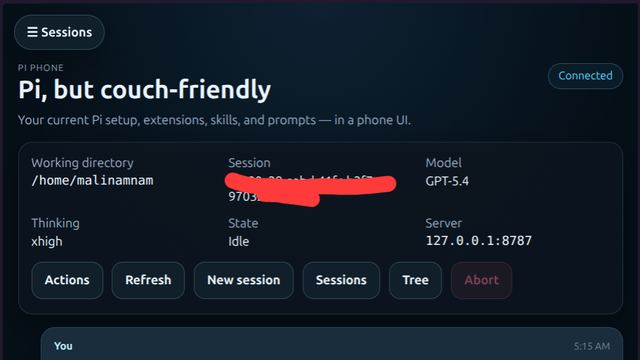</a> <b><a href="https://github.com/MaliNamNam/pi-phone">pi-phone</a></b> · ⭐ 61 Mirrors the active session and can start parallel sessions. Screenshot: <a href="https://github.com/MaliNamNam/pi-phone">from the project</a></td><td width="50%"></td></tr>
</table>

| Project | Platforms | How the phone reaches Pi | Stars | What you get |
|---|---|---|---|---|
| [Pi Pocket](https://github.com/tannermidd/pi-pocket) | Any browser | Self-hosted server | ⭐ 841 | Durable, multiplayer, mobile-first web app for Pi; runs keep going after a restart. |
| [pi-agent-dashboard](https://github.com/BlackBeltTechnology/pi-agent-dashboard) | Any browser | Web server next to Pi | ⭐ 348 | Multi-session dashboard with live chat mirroring and a terminal; its mobile layout (swipe drawer, large touch targets) works over mDNS or a zrok tunnel. |
| [Pi-Remote (browser)](https://github.com/Xpropel/Pi-Remote) | Any browser | Pi extension serving a web page | ⭐ 330 | Mirrors a live terminal session to the browser; send messages and commands back. |
| [pi-phone](https://github.com/MaliNamNam/pi-phone) | Any browser | Local web server | ⭐ 61 | Mirrors the active session and can start parallel sessions. |
| [pi-mobile (web)](https://github.com/p1rallels/pi-mobile) | Any browser | Tailscale or Cloudflare Tunnel | ⭐ 28 | Start, monitor and resume sessions. |
| [pi-anywhere](https://github.com/feng-h/pi-anywhere) | Any browser | Cloudflare Tunnel | ⭐ 1 | A chat UI for the same Pi instance; no tmux or terminal emulator. |

## Notifications

Get told when Pi finishes or needs you, and answer from the lock screen or a push service.

<table>
<tr><td width="25%" valign="top"><a href="https://www.pipulse.dev/">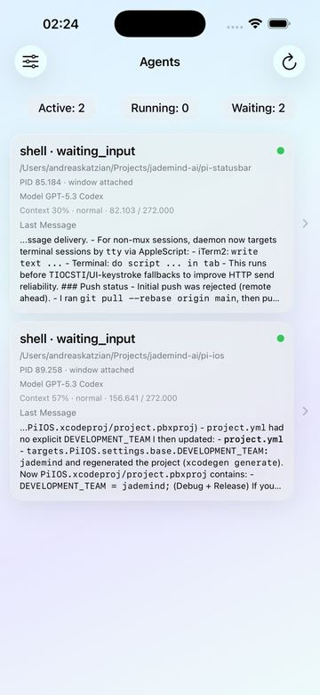</a> <b><a href="https://www.pipulse.dev/">Pi Pulse</a></b>  Approve, reject or reply to a session from the phone. Screenshot: <a href="https://apps.apple.com/us/app/pi-pulse/id6759630191">from the project</a></td><td width="25%"></td><td width="25%"></td><td width="25%"></td></tr>
</table>

<table>
<tr><td width="50%" valign="top"><a href="https://github.com/Asigers/pi-knock">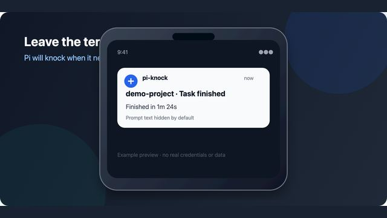</a> <b><a href="https://github.com/Asigers/pi-knock">pi-knock</a></b> · ⭐ 114 Notifies when a task finishes or needs input. Screenshot: <a href="https://github.com/Asigers/pi-knock">from the project</a></td><td width="50%"></td></tr>
</table>

| Project | Platforms | How the phone reaches Pi | Stars | What you get |
|---|---|---|---|---|
| [pi-knock](https://github.com/Asigers/pi-knock) | Pushover, ntfy, webhooks | Push service | ⭐ 114 | Notifies when a task finishes or needs input. |
| [Pi Pulse](https://www.pipulse.dev/) | Phone, macOS menu bar | Bridge package and a menu bar companion | — | Approve, reject or reply to a session from the phone. |

## Multi-agent apps with Pi support

Clients for several coding agents that also drive Pi.

<table>
<tr><td width="25%" valign="top"><a href="https://github.com/getpaseo/paseo">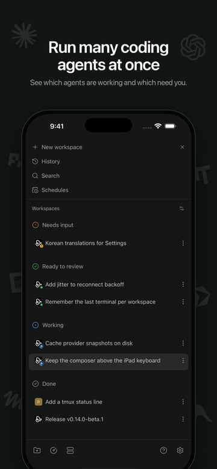</a> <b><a href="https://github.com/getpaseo/paseo">Paseo</a></b> · ⭐ 24.1k Runs Pi, Claude Code, Codex and more in parallel; has a page for Pi. Screenshot: <a href="https://github.com/getpaseo/paseo">from the project</a></td><td width="25%" valign="top"><a href="https://github.com/pi-pod/pipod">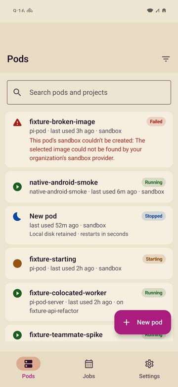</a> <b><a href="https://github.com/pi-pod/pipod">pi pod</a></b> · ⭐ 167 Runs Pi sessions in remote sandboxes you host, with native phone apps to start and follow them. Screenshot: <a href="https://github.com/pi-pod/pipod">from the project</a></td><td width="25%" valign="top"><a href="https://github.com/sesori-ai/sesori_apps_monorepo">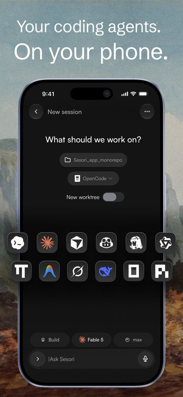</a> <b><a href="https://github.com/sesori-ai/sesori_apps_monorepo">Sesori</a></b> · ⭐ 143 One phone app for several coding agents, Pi among them: get notified when one needs you and answer from the phone. Screenshot: <a href="https://apps.apple.com/us/app/sesori-remote-ai-coding-agent/id6760642500">from the project</a></td><td width="25%" valign="top"><a href="https://github.com/gal064/muxflow">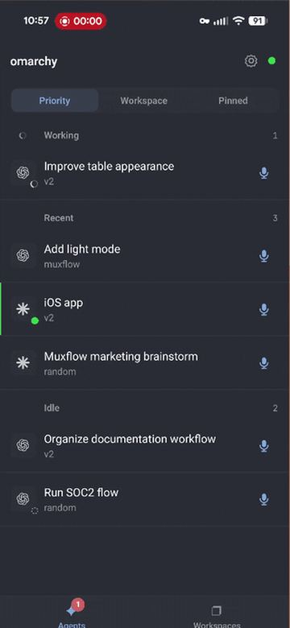</a> <b><a href="https://github.com/gal064/muxflow">Muxflow</a></b> · ⭐ 117 Notifications when Pi needs input, voice replies, files and Git. Screenshot: <a href="https://github.com/gal064/muxflow">from the project</a></td></tr>
</table>

| Project | Platforms | How the phone reaches Pi | Stars | What you get |
|---|---|---|---|---|
| [Paseo](https://github.com/getpaseo/paseo) | iPhone, Android, desktop, web | End-to-end encrypted relay, or your own machine | ⭐ 24.1k | Runs Pi, Claude Code, Codex and more in parallel; has a page for Pi. |
| [pi pod](https://github.com/pi-pod/pipod) | iPhone, Android, terminal | Your own server | ⭐ 167 | Runs Pi sessions in remote sandboxes you host, with native phone apps to start and follow them. |
| [Sesori](https://github.com/sesori-ai/sesori_apps_monorepo) | iPhone, Android, desktop | App on your computer | ⭐ 143 | One phone app for several coding agents, Pi among them: get notified when one needs you and answer from the phone. |
| [Muxflow](https://github.com/gal064/muxflow) | Desktop, Android | SSH and tmux | ⭐ 117 | Notifications when Pi needs input, voice replies, files and Git. |

## Do it yourself

No extra app: reach the terminal Pi runs in.

| Project | Platforms | How the phone reaches Pi | Stars | What you get |
|---|---|---|---|---|
| [Pi in Termux](https://pontia.dev/blog/pi-coding-agent-remote-control) | Android | Runs on the phone itself | — | Run Pi on the phone without another machine. |
| [SSH + mosh + tmux](https://michaelhutchinson.me/blog/working-on-the-pi-from-my-phone/) | Any SSH app | A private network such as Tailscale | — | Keep Pi in tmux and attach from the phone; mosh survives sleep and network changes. |

## Choosing one

| If you want | Look at |
|---|---|
| No port, no VPN, no server to run | Projects that use a relay: Hey Atu, Remote Pi, Paseo, pi.dev remote |
| Everything open source and self-hosted | Pi Pocket, pi-agent-dashboard, pi-mobile (web), pi pod |
| Only to know when Pi needs you | pi-knock, Pi Pulse |
| Android | Remote Pi, Pi Mobile (Android), π Remote, Muxflow |
| More than coding from the phone | Hey Atu (to-dos, scheduled updates, a wiki) |
| Nothing new to install | SSH + mosh + tmux |

A remote client can make commands run on your computer. Check how each one authenticates and whether its relay can read your messages before you pair it.

## Guides and discussions

- [How I Use Pi Coding Agent Remotely from My Phone](https://daniellemky.com/posts/how-i-use-the-pi-coding-agent-remotely-from-my-phone/) — Daniel Lemky
- [Use the Pi coding agent from your phone: SSH, apps or BotBus](https://botbus.io/en/blog/pi-coding-agent-on-your-phone) — BotBus
- [How to use Pi coding agent from your phone](https://pontia.dev/blog/pi-coding-agent-remote-control) — Pontia
- [Which Pi Mobile Client?](https://www.reddit.com/r/PiCodingAgent/comments/1xchcra/which_pi_mobile_client/) — r/PiCodingAgent
- [Are you using pi on mobile?](https://www.reddit.com/r/PiCodingAgent/comments/1v7wne4/are_you_using_pi_on_mobile/) — r/PiCodingAgent

## Contributing

Know a project that is missing, or a detail that changed? Open an issue or a pull request. Edit [`data/projects.json`](data/projects.json) and run `node scripts/build.mjs`; the README is generated from it.

An entry needs to work with Pi from a phone and be available to try today, or say clearly when it is coming.

---

¹ Hey Atu is made by the maintainers of this list. It is listed with the same fields as every other project. Its picture is sample content; the iPhone app is coming soon.

Screenshots come from each project's App Store page, README or site, and belong to their owners. Want yours changed or removed? Open an issue.

[CC0](LICENSE): to the extent possible under law, the authors have waived all copyright to this list.
